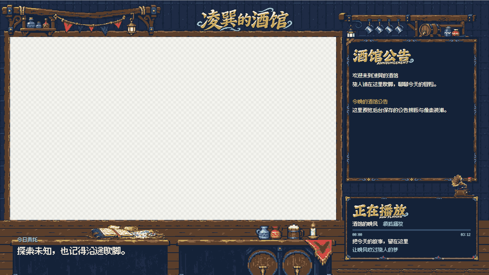

# 凌巽的酒馆

像素酒馆主题的本地直播装修工具，提供 Windows 桌面控制台、双平台独立直播页面、网易云歌曲与同步歌词，以及可实时修改的公告、今日委托和分区字号。

直播画布固定为 **1920 × 1080**，游戏窗口为 **1280 × 720 真透明区域**。B 站和抖音共用酒馆美术，各自保存公告、字号与歌词设置。



## 当前功能

- **桌面控制台** — 编辑文本和字号，查看场景、独立素材与双平台实时画面，启动和停止本地服务。
- **模块化像素场景** — 木质游戏框、双桌面、地图账本、酒桶挂杯架、栏目艺术字与框上留声机。
- **独立平台设置** — 两个平台分别编辑公告和歌词选项，保存后通过 WebSocket 实时同步。
- **网易云音乐** — 读取本机客户端的歌曲、歌手、进度和同步歌词，支持播放/暂停、上一首、下一首。
- **播放区自动隐藏** — 开启后，暂停或切歌的短暂空档保留播放区，连续 5 秒未恢复播放才隐藏。
- **配置持久化** — 服务端校验、原子保存和历史备份，用户设置与进程运行记录分开管理。

### 平台接入状态

| 模块 | 当前状态 |
| --- | --- |
| 网易云音乐 | 已完成本机真实连接、歌词与播放控制验证 |
| B 站互动 | 保存房间地址，等待官方开放平台授权，未连接时自动显示公告 |
| 抖音页面 | 固定显示该平台独立公告 |
| 场景预览 | 可切换模拟留言与公告，展示弹幕、礼物、舰长和 SC 的视觉效果 |

右栏公告与底部公告互斥显示。右栏为公告时隐藏底部公告，右栏为留言时显示底部公告。顶部“凌巽的酒馆”沿用固定艺术字。

## Windows 应用

### 本机交付文件

| 文件 | 位置 |
| --- | --- |
| 完整应用压缩包，约 173 MiB | `release/凌巽的酒馆-Windows-x64.zip` |
| 解压后的程序入口 | `release/凌巽的酒馆-win32-x64/凌巽的酒馆.exe` |

应用通过完整压缩包交付，构建产物保存在本地 `release/` 并由 Git 忽略。从源码生成应用的步骤见下方“构建 Windows 应用”。

1. 将压缩包完整解压，保留应用文件夹内的所有文件。
2. 双击“凌巽的酒馆.exe”，程序会启动本地服务并打开后台。
3. 在后台编辑今日委托、两平台公告、各区字号和歌词选项，点击“保存设置”。
4. 播放音乐时，打开本机网易云客户端，启用后台的“本地网易云连接”，使用默认桥接地址 `http://127.0.0.1:18726`。
5. 从顶部“预览”菜单查看实时画面，从“直播服务”菜单复制对应平台的直播源链接。

关闭窗口时可以选择保留直播服务，或停止服务并退出。再次打开应用会复用自身已运行的服务实例。

应用包含 Electron 和 Python 桥接运行环境。网易云桌面客户端需安装在使用电脑上，当前实测版本为 **3.1.41.205564**。

## 在直播软件中使用

服务默认监听 `127.0.0.1:3000`，直播软件的网页源尺寸设为 **1920 × 1080**。

| 页面 | 默认地址 |
| --- | --- |
| B 站直播源 | http://127.0.0.1:3000/live/bilibili |
| 抖音直播源 | http://127.0.0.1:3000/live/douyin |
| 管理后台 | http://127.0.0.1:3000/admin |
| 场景与美术预览 | http://127.0.0.1:3000/scene/review |
| 独立像素素材 | http://127.0.0.1:3000/assets/review |
| 布局线框预览 | http://127.0.0.1:3000/preview |

游戏窗口位于 `X=40、Y=144`。将游戏捕获放在网页装饰层下方，由直播软件捕获游戏、音频并编码推流。OBS 可按使用习惯选择。

两个直播源可以同时运行。调整端口后，以应用或启动器显示的实际地址为准。场景预览中的模拟留言和歌曲用于检查排版，正式直播源读取真实音乐及对应平台的运行状态。

## 从源码运行

需要 Node.js **22.12 或更新版本**。网易云桥接依赖 Windows，安装说明见 [网易云本地桥接](docs/MUSIC_SETUP.md)。

```powershell
git clone https://github.com/LingXunFurry/livestreaming_tool.git
cd livestreaming_tool
npm ci
npm start
```

随后在浏览器打开管理后台。正常启动时，统一入口会检查依赖、构建页面并启动后台服务。

| 操作 | npm 命令 | Windows 入口 |
| --- | --- | --- |
| 启动服务 | `npm start` | `启动直播间.bat` / `start.bat` |
| 检查状态 | `npm run status` | `检查运行状态.bat` / `status.bat` |
| 停止服务 | `npm stop` | `关闭直播间.bat` / `stop.bat` |
| 桌面开发入口 | `npm run desktop` | Electron 窗口 |

日常选择一种启动方式，切换方式时先从原入口停止服务。源码脚本与桌面入口各自保存配置。

源码运行时，在后台启用默认音乐地址后，统一启动器会尝试自动启动已安装的网易云桥接。桥接安装、版本与故障排查见 [MUSIC_SETUP.md](docs/MUSIC_SETUP.md)。

## 构建 Windows 应用

构建环境为 Windows x64。封装脚本使用 **Python 3.14.3 嵌入式运行环境**，用于打包的 `.cache/netease-venv` 应使用 Python 3.14 创建，并按桥接安装说明安装依赖。

```powershell
npm ci
npm run package:desktop
```

命令会构建页面并输出 `release/凌巽的酒馆-win32-x64/`。在 PowerShell 中运行以下命令可将整个应用目录打包为 ZIP。

```powershell
Compress-Archive -LiteralPath "release/凌巽的酒馆-win32-x64" -DestinationPath "release/凌巽的酒馆-Windows-x64.zip" -Force
```

首次构建会下载 Electron 和 Python 运行环境。已使用的桥接源码和 Python 依赖需要先安装在项目的 `.cache/` 下，具体步骤见 [MUSIC_SETUP.md](docs/MUSIC_SETUP.md)。

## 设置、备份与日志

| 内容 | 源码脚本入口 | 桌面应用入口 |
| --- | --- | --- |
| 普通设置 | `data/settings.json` | `%APPDATA%/LingxunTavern/settings.json` |
| 历史备份 | `data/backups/` | `%APPDATA%/LingxunTavern/backups/` |
| 日志 | `data/logs/` | `%APPDATA%/LingxunTavern/logs/` |
| 运行记录 | `data/runtime/` | `%APPDATA%/LingxunTavern/runtime/` |

首次启动根据 `config/example.json` 初始化设置。本机交付时已将原项目设置复制到桌面应用的用户目录。后续修改通过各自后台保存，桌面菜单可打开设置与日志目录。

普通配置包括公告正文、今日委托、字号、音乐地址和歌词选项。公告支持加粗和固定色板文字，语法与字段范围见 [产品规范](docs/PROJECT_SPEC.md)。

## 开发与验证

```powershell
npm run check
npm run build
npm test
```

开发热更新使用 `npm run dev`，页面位于 `http://127.0.0.1:5173`，API 请求代理到本地 3000 端口。迁移测试使用 `npm run test:migration`，会创建独立目录并联网安装依赖。

本机已完成构建、24 项 Node.js 测试、双平台八种场景组合、文字下伸笔画裁切回归，以及封装应用的保存、预览、真实音乐回读、播放控制和服务关闭/重开验证。

| 记录 | 内容 |
| --- | --- |
| [桌面应用验证](docs/DESKTOP_REVIEW.md) | 封装方式、测试结果与本机依赖 |
| [桌面应用机器记录](docs/DESKTOP_APP_CHECKS.json) | 设置保存、预览、播放控制与生命周期 |
| [网易云冷启动记录](docs/DESKTOP_COLD_START_CHECK.json) | 从停止到启动的真实连接 |
| [装潢追加记录](docs/ART_REVISION_REVIEW.md) | 最新场景、对齐与字号检查 |
| [阶段进度](docs/CHECKPOINTS.md) | CP0 至 CP6 已通过，CP7 进行中 |

第二台电脑、直播客户端的完整兼容性和长时间稳定性仍需实机验证。网易云升级可能影响第三方桥接的客户端适配。

## 素材与项目结构

```text
desktop/              Windows 桌面入口
src/                  React 后台、直播页与预览
server/               配置、HTTP/WebSocket 与音乐适配
scripts/              服务生命周期、封装和离线美术制作
config/               默认配置与字号范围
assets/generated/     像素素材与生成源稿
assets/prompts/       生图提示词
assets/layouts/       离线组合配方
assets/backgrounds/   组合背景
docs/                 规范、检查记录与截图
release/              本地 Windows 应用与压缩包
```

当前装潢配方为 `assets/layouts/cp3-tavern-art.json`，美术清单位于 `assets/manifest.json`。素材采用固定十色、像素硬边和透明 PNG。栏目正文使用随项目分发的 Fusion Pixel 字体，并附上游许可证。

- [产品规范](docs/PROJECT_SPEC.md)
- [视觉设计系统](docs/DESIGN_SYSTEM.md)
- [素材来源与授权政策](docs/ASSET_POLICY.md)
- [技术架构](docs/ARCHITECTURE.md)
- [服务运行与恢复](docs/RUNTIME.md)
- [Fusion Pixel 字体来源](assets/fonts/fusion-pixel/SOURCE.md)

角色原稿的使用和修改依照素材政策取得单独授权，素材与字体的来源、许可和验收状态以项目清单及随附文件为准。
